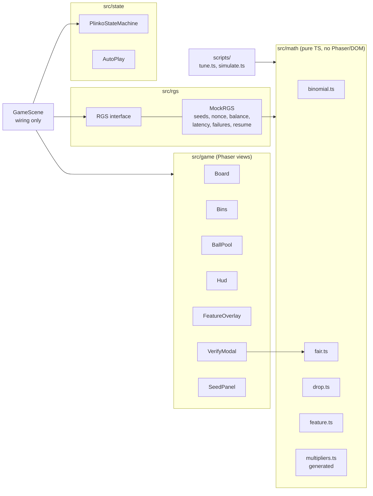
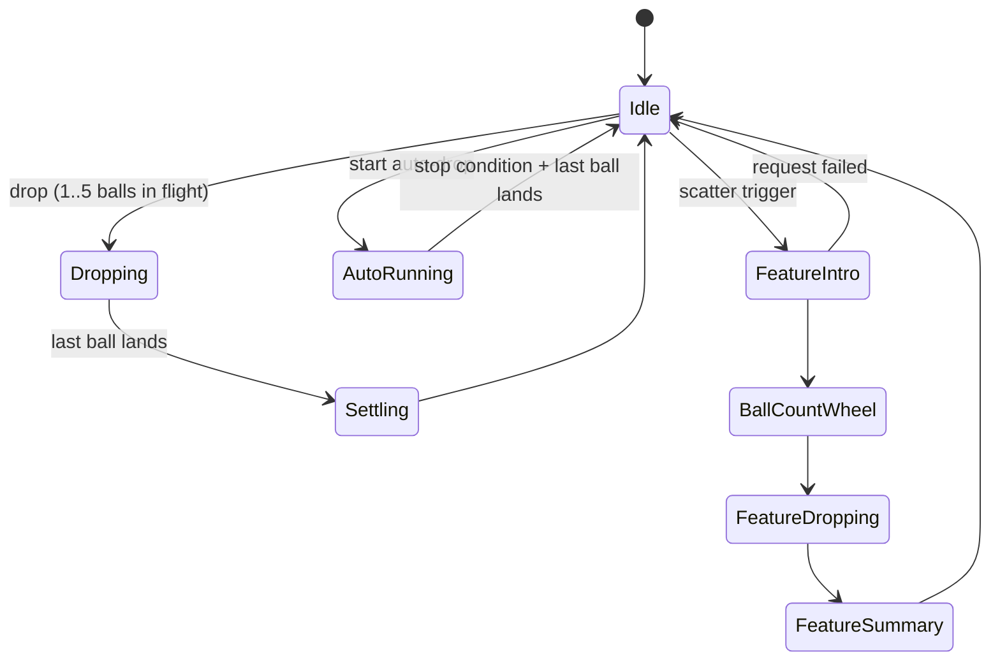

# Swerte Drop

A Phaser 3 Plinko game. A mock RGS (remote game server) decides every result, and the client only animates the result it receives. Every combination of rows and risk is tuned to a 97% RTP and checked by simulation. Each round can be verified on the provably fair screen. The same board also runs a slot-style multi-ball bonus round.

**Original content, play money only.** All RTP figures are simulated or computed analytically. Nothing here is certified.

- **Live demo:** https://minterwelon-dev.github.io/Swerte-Drop--Plinko-Game/ (deployed by `.github/workflows/pages.yml` on every push to `main`)
- **Video (40 s):** [docs/demo.mp4](docs/demo.mp4). Shows a normal drop, high risk at 16 rows, auto-drop stopping on its loss limit, the verify screen and the feature round.
- **Simulation report:** [docs/simulation-report.txt](docs/simulation-report.txt)

## Run

```sh
npm ci
npm run dev        # dev server with the DEV debug panel
npm run build      # production bundle (debug code stripped)
npm test           # Vitest
npm run tune       # regenerate src/math/multipliers.ts
npm run simulate -- --rows 16 --risk high --drops 10000000 --seed 42
npm run simulate -- --feature --features 1000000 --seed 42
npm run simulate -- --all  # all 15 tables + the feature, writes docs/simulation-report.txt
```

In dev builds only, URL parameters configure the mock: `?seed=42` makes the session deterministic, `&latency=300` adds latency in ms and `&fail=0.2` sets a failure rate. The debug panel can also force a bin or the edge bin.

## Game

- **Board:** 8, 10, 12, 14 or 16 rows. Risk is low, medium or high. Each peg sends the ball left or right with even odds, so `P(bin k) = C(n, k) / 2^n`.
- **Bets:** 1.00 to 50.00. Up to 5 balls can be in flight at once, and each ball is its own round with its own nonce.
- **Controls:** Turbo shortens the timing. Skip lands every ball at once.
- **History and tooltips:** a history strip shows the last 20 results. Hovering or tapping a bin shows its multiplier and landing probability, generated from the math data.
- **Auto-drop:** 10, 25, 50 or 100 rounds. A loss limit is required. It can also stop on a single win, on total profit or when the balance falls below a set amount. Auto-drop pauses while the tab is hidden.
- **Feature:** the **Feature** button starts the Stage B bonus round (see below).

## Architecture



How the work is split:

- **`math/`** owns all outcome logic. It is deterministic given the seeds, and Node, Vitest and the scripts all run it.
- **`rgs/`** wraps `math/` behind the contract the client uses. The client only talks to the `RGS` interface.
- **`state/`** decides what may happen next.
- **`game/`** modules each own one view. They never call the RGS and never decide outcomes.
- **`GameScene`** connects these pieces.

The ball follows waypoints derived only from `response.path`, so it always lands in `response.bin`. There is no physics engine. Dev builds assert `sum(path) === bin`.

### Round flow



The server settles each round instantly. The HUD shows a separate **display balance** that changes only when a bet is placed or a ball lands. With no balls in flight, dev builds assert that the display balance equals the server balance.

If the page is refreshed mid-drop or mid-feature, rounds that settled but were never acknowledged come back from `init()` and animate to their landing.

## RGS contract (mock)

```ts
interface DropRequest  { sessionId: string; bet: number; rows: 8 | 10 | 12 | 14 | 16; risk: 'low' | 'medium' | 'high' }
interface DropResponse {
  roundId: string; nonce: number; serverSeedHash: string; clientSeed: string;
  rows: Rows; risk: Risk; bet: number;
  path: number[];          // length = rows, 0 = left, 1 = right
  bin: number;             // sum(path)
  multiplierX100: number;  // 1.50x = 150
  win: number;             // minor units, bet * multiplierX100 / 100
  balance: number;         // after the round
}
interface SeedState      { serverSeedHash: string; clientSeed: string; nonce: number }
interface RotateResponse { revealedServerSeed: string; newServerSeedHash: string }
interface SessionInit    { sessionId: string; balance: number; seed: SeedState; pending: DropResponse[]; pendingFeature: FeatureResult | null }

interface RGS {
  init(): Promise<SessionInit>;
  drop(req: DropRequest): Promise<DropResponse>;
  feature(req: FeatureRequest): Promise<FeatureResult>;  // see Stage B
  ack(roundId: string): Promise<void>;                    // presented; no longer resumed after refresh
  setClientSeed(clientSeed: string): Promise<SeedState>;
  rotateSeed(): Promise<RotateResponse>;
}
```

Errors are typed as `NETWORK`, `INSUFFICIENT_FUNDS`, `BAD_REQUEST` and `BAD_SESSION`. On a network failure, the client first checks `init().pending` for a round that settled but whose response was lost. If there is none, it offers a retry, so a bet is never taken twice. The mock persists its state to `localStorage`. Latency and failure rate can be injected.

Money is integer minor units throughout. Multipliers are integer hundredths. Bet levels are multiples of 100, so wins are exact.

## Provably fair (mock)

1. Before play, the mock commits to a server seed of 32 random bytes and shows its SHA-256 hash.
2. The player can edit the client seed. The nonce starts at 0 and goes up by 1 per round.
3. The path comes from `HMAC-SHA256(serverSeed, "${clientSeed}:${nonce}")`. Bit `i`, computed as `(bytes[i >> 3] >> (i & 7)) & 1`, is the move at row `i`: 0 = left, 1 = right. The landing bin is `sum(path)`.
4. **Rotate** reveals the old server seed, commits a new hash and resets the nonce.
5. **Verify a round** takes the server seed, client seed, nonce, rows and risk. It recomputes the hash check, path, bin and multiplier using the same `fair.ts` the mock server uses.

**Honest note:** in this mock, the server seed lives in the browser. It demonstrates the protocol, not a real trust model. Regulated markets use certified RNGs and lab testing instead.

## Math and simulation

- **15 tables** (5 row counts × 3 risks), symmetric, centre bin lowest.
- `scripts/tune.ts` generates them into `src/math/multipliers.ts`, which is never edited by hand.
  - **Shape:** `m_k = c · exp(α · |k − n/2|^β)`. The centre `c` and `β` are fixed per risk, and `α` is solved so the RTP hits 97%.
  - **Rounding:** values are rounded to hundredths. The symmetric bin pairs then absorb the rounding drift, working outward from the centre.
- **Centres:** low ≈ 0.5x, medium ≈ 0.3x, high ≈ 0.2x.
- **Maxima:** from 4.94x (8 rows, low) up to 999.96x (16 rows, high).
- **RTP window:** Vitest fails if any table's analytical RTP falls outside 96.9% to 97.1%.
- **Simulation:** `simulate --all` checks each table with 10M drops. It reports:
  - simulated RTP against the analytical value, within 3 standard errors
  - hit frequency and volatility
  - longest losing run and P99 drawdown
  - a chi-square test of bin frequencies (p > 0.001)
- Same seed, same report. The committed report covers every table and the feature.

## Stage B: Plinko Feature

This shows the board reused as a slot-style bonus round. The **Feature** button simulates the scatter trigger. In the slot, this would be 3 scatters.

1. **Intro.** The feature request goes out while the intro plays.
2. **Ball count wheel.** The wheel awards 10, 12, 15, 20, 25 or 30 balls. Segment sizes match their weights.
3. **Drop.** A 12-row board shows coin bins plus Mini (20x), Minor (100x) and Major (1000x) jackpot bins at the edges. Balls drop in a rapid sequence, up to 5 at a time. The running total and the balance go up as each ball lands.
4. **Summary.** Shows the ball count, jackpot hits and total win.

The feature total is capped at **5000x the triggering bet**. `src/math/feature.ts` enforces the cap. The feature is free because the triggering spin already paid the bet. Every step can be skipped: tap the overlay or press Skip. Turbo shortens the wheel and the ball timing. Refreshing mid-feature replays the settled feature from the start.

The values in `src/math/feature.ts` set the bins, jackpot values and wheel weights. `docs/simulation-report.txt` has the measured figures: average total of about 47.9x bet, jackpot hit rates and cap frequency.

### Fairness

A feature uses consecutive nonces:

- **Wheel:** nonce `N`. The first 4 HMAC bytes, read as a little-endian uint32, give the ball count. Segment `i` covers its weight's share of `[0, 2^32)`.
- **Balls:** ball `i` uses nonce `N + 1 + i` with the classic 12-row path protocol.

So a feature with `b` balls consumes `1 + b` nonces. `deriveFeature(serverSeed, clientSeed, nonce, bet)` replays the whole feature.

### Integration interface

A slot client calls the RGS feature endpoint once, after the trigger. The server settles the whole bonus round in one response:

```ts
type SeedRef = { serverSeedHash: string; clientSeed: string };

interface FeatureRequest {
  sessionId: string;
  bet: number;      // triggering bet, minor units
  seedRef: SeedRef; // seed pair the client expects; a stale ref is rejected (BAD_REQUEST)
}

interface FeatureResult {
  roundId: string;
  nonce: number;    // wheel nonce; ball i used nonce + 1 + i
  serverSeedHash: string;
  clientSeed: string;
  bet: number;
  balls: {
    path: number[]; // 12 moves, 0 = left, 1 = right
    bin: number;    // sum(path)
    multiplierX100: number;
    win: number;    // minor units, bet * multiplierX100 / 100
    tier?: 'mini' | 'minor' | 'major';
  }[];
  totalWin: number; // min(sum of wins, 5000 * bet)
  capped: boolean;
  balance: number;  // after the feature
}
```

Contract:

- `balls.length` is the wheel result.
- The client presents the balls in order and credits each win as its ball lands, never beyond `totalWin`.
- After the summary, the client calls `ack(roundId)`. Until then, `init()` returns the round as `pendingFeature`, so a refresh resumes it.
- Only one feature can be pending at a time.

On the client side, the reusable pieces are:

- `Board` and `Bins`: they render any `BinDef[]`. See `featureBinDefs()`.
- `FeatureOverlay`: intro, wheel, running total and summary.
- The `FeatureIntro -> BallCountWheel -> FeatureDropping -> FeatureSummary` states in `PlinkoStateMachine`.

DEV only: **Force edge** in the debug panel, then **Feature**, plays 30 Major balls. This shows the 5000x cap.

## Performance and bundle

### Current: roomier phone layout and corrected diamonds (2026-10-14)

- Portrait uses the full available height. At 360x640 the board is **352x395 px**, previously **331x291 px** (about 36% taller). The canopy/title/stats are compact; tall phones give their additional height to the board.
- Rows, risk, fairness, feature and sound are in the portrait **Setup** panel. Bet/drop and turbo/auto/skip remain directly accessible. Setup closes with Close, Escape, an outside tap or landscape rotation. Board-changing controls still obey the round state.
- At 14 and 16 rows, portrait ticket text runs vertically for larger readable multipliers. Landscape and history labels remain horizontal. Tapping a bin still shows its probability and multiplier.
- Imagegen removed the flawed corner diamonds from the board material. A single mirrored stencil now produces matching diamonds below the BOLA badge. The corrected source and prompt are preserved in [`Assets/art/`](Assets/art/README.md). Bungee and Nunito Sans are retained.
- Build, lint and **90 tests pass**. Muted Chrome checks: 320x568, 360x640, 390x844, 1280x720, 1920x1080; Setup visibility/layering and Escape, row selection, all 15 tables, five-ball control locking, live rotation, skip, turbo and settlement. No runtime exceptions. Screenshots/results: [`docs/layout-v2-review/`](docs/layout-v2-review/).
- Current art payload: **207.21 kB**. Physical-device performance remains unmeasured. The full animation phases are separate from this layout revision.

### Earlier imagegen materials (2026-10-14; layout and board superseded)

The perya canopy, framed felt board, wooden sign and counter now use built-in imagegen artwork. Three optimized local WebP assets total **263.55 kB**. Original PNGs and exact prompts are preserved in [`Assets/art/`](Assets/art/README.md). Fonts remain Bungee and Nunito Sans; values and gameplay objects stay live.

Build, lint and 89 tests pass. The browser layout/control checks described below were repeated with the new artwork; no runtime exceptions, all 15 row/risk combinations rendered, and five-ball rotation/skip settled correctly. Current screenshots and results: [`docs/imagegen-review/`](docs/imagegen-review/). New animation phases remain pending the existing layout-review gate; this pass changes art only.

### Reference layout, Phase A (2026-10-14; procedural materials superseded)

Implemented the portrait and landscape references from `SWERTE_UI_ANIMATION_SPEC.md`, retaining Bungee and Nunito Sans as requested. The striped canopy, hanging wooden sign, felt/brass board, ticket bins, balance/win plaques, wooden controls and nine-result history are drawn in Phaser. Multipliers and colours come from the existing tables; empty history slots remain empty.

- Build and lint pass; 89 tests pass, including board bounds for all row counts, ticket colour boundaries and normal/turbo/skip ball endpoints.
- Muted headless Chrome: 360x640 and 390x844 at DPR 2; 1280x720 and 1920x1080 at DPR 1. Canvas bounds and both local fonts verified.
- All 15 row/risk combinations render the expected bin count. Actual pointer controls exercised rows, drop, turbo and skip. Five concurrent balls disable bet/row/risk controls; rotating then skipping settles with equal display/server balances. No runtime exceptions.
- Review images and repeatable CDP check: [`docs/phase-a-review/`](docs/phase-a-review/). The browser check expects the dev server on port 5173 and a muted Chrome debugging endpoint on 9339.
- Stopped at the spec's explicit **Phase A: layout (stop for review)** gate. Existing ball/landing and modal presentation remains functional; the new Phase B-D animation system is pending layout approval. Physical-device and current-layout performance profiling have not been performed.

### Earlier visual pass (superseded layout)

- **Visual update check (2026-10-14):** development build in muted headless Chrome at 390×844 @3x and 4x CPU throttle, with 5 balls in flight on 16 rows.
  - Result: **103.0 fps** average over a 1.2-second sample; worst frame 14.4 ms. Five balls were still in flight at the end of the sample.
  - This is a desktop GPU measurement, not evidence of sustained performance on a real Android device or iPhone.
- **Browser checks:** normal drop, turbo, skip, row/risk controls, live rotation during a drop, feature intro/wheel/skip, settlement, button press feedback, reduced motion, local font loading. No runtime errors. Display and server balances matched when idle.
- **Production layouts:** 320×568, 390×844, 844×390, 1440×900 and 1024×768, including a live DPR 2 to DPR 1 transition. Canvas CSS bounds and backing resolution checked at every size. No external HTTP requests or debug UI.
- Screenshots and measured results: [`docs/visual-review/`](docs/visual-review/). These checks do not replace physical-device testing.
- **Rendering:** pegs are baked into one texture per layout. Balls, peg flashes and popups are pooled, and the update loop allocates nothing.
- **Bundle** (`npm run build`, Phaser 3.90 is most of it):

| File | Raw | Gzip |
|---|---|---|
| `index-*.js` | 1,264.55 kB | 341.25 kB |
| `index-*.css` | 2.90 kB | 1.14 kB |
| `index.html` | 0.57 kB | 0.38 kB |
| Bungee WOFF2 | 14.34 kB | Already compressed |
| Nunito Sans WOFF2 | 31.07 kB | Already compressed |

Sizes above are reported by Vite. The two font licenses add 8.87 kB raw under `dist/licenses/`. Generated WebP art adds 207.21 kB raw; source PNGs are excluded. Sounds are synthesised. Fonts are bundled locally, with a 1.5-second boot timeout and a system-font fallback.

The production bundle contains no debug panel, no forced-outcome code and no `console.error`.

## Visual direction and credits

The perya treatment follows the supplied references: striped red/cream canopy, wooden sign and counter, green felt, brass pegs, warm bulbs and notched prize tickets. The cloth, wood and framed felt are generated raster artwork; lettering remains real text and diamond decorations stay outside the peg field. No third-party photography is included.

- **Title and Drop button:** [Bungee by David Jonathan Ross](https://djr.com/bungee), a signage-oriented typeface, licensed under the SIL Open Font License. Source: [Google Fonts](https://github.com/google/fonts/tree/main/ofl/bungee).
- **Controls and body text:** [Nunito Sans](https://github.com/googlefonts/NunitoSans), licensed under the SIL Open Font License. Source: [Google Fonts](https://github.com/google/fonts/tree/main/ofl/nunitosans).
- Local Latin-subset WOFF2 files are in `Assets/fonts/`; redistribution licenses are in `public/licenses/` and copied into each production build.
- Visual research: [Inquirer's perya in Pasig](https://newsinfo.inquirer.net/1207848/a-perya-in-pasig) and [GMA's perya feature](https://www.gmanetwork.com/news/newstv/ijuander/283880/i-juander-saan-nagmula-ang-perya-sa-bayan-ni-juan/story/). These are reference sources only; their photographs were not copied or redistributed.

Phase B adds hopper loading/release, ball hops and impact squash, pooled trails and peg flashes, landing compression, cash tags, win/balance count-up, sliding history tickets, button press/toggle/disabled feedback, bet rolling and limit feedback, and active-ball badge transitions. Sub-1x results stay subdued. Skip finishes both ball travel and monetary presentation; turbo shortens motion and removes trails. System reduced motion suppresses decorative movement and flashes. Ball waypoints, payout values and landing credit remain server-driven; animation does not choose outcomes.

Presentation timing controls are in `gameConfig.motion`. The history shows nine results: one row in portrait and a 3-by-3 grid in landscape. Dense 16-row bin labels are still small on narrow phones; tap a bin for its larger multiplier/probability tooltip.

### Phase B animation validation (2026-10-14)

- [Recorded preview](docs/phase-b-review/phase-b-preview.webm), [screenshots and browser checks](docs/phase-b-review/), and [measured results](docs/phase-b-review/results.json). Run `node docs/phase-b-review/check.mjs` with the dev server on 5173 and muted Chrome remote debugging on 9339.
- 93 tests, TypeScript/Vite build and ESLint pass. Browser checks cover press/release, bet limits and affordability clamp, normal and subdued landings, count-up skip, five-ball rotation/turbo/skip, feature settlement, and reduced motion. All recorded landing positions match their response bins; display, server and HUD balances agree after settlement. No runtime exceptions.
- The existing Ball and Board modules own travel and peg effects; the animation director coordinates their presentation with pooled win tags, HUD and history effects. Button fills are cached into textures on layout/state changes, avoiding per-frame path triangulation.
- **Performance remains below acceptance:** the latest 900 ms five-ball sample at 390x844, DPR 2 and 4x CPU throttle averaged **43.8 FPS**, worst frame **34.8 ms**. This headless desktop/SwiftShader result does not establish physical-device performance or satisfy the 55 FPS target.
- Current production JavaScript: **1,278.06 kB raw / 344.85 kB gzip**; CSS **2.90 / 1.14 kB**; HTML **0.57 / 0.37 kB**. Generated WebP art remains **207.21 kB**. Production scanning found no debug panel, forced-outcome handling or `console.error`.
- Phase C ambient/big-win/modal polish and Phase D feature presentation remain pending. Physical Android/iOS testing and the full reduced-motion settings pass are still outstanding.

### Phase C polish (2026-10-14)

Implemented canopy/bulb entrance, board/counter rise, sign sway and win bump, bulb chase, HULOG breathing/idle hint, SKIP pulse, and pooled BIG / MEGA / EPIC win signs. The signs reuse the approved wood artwork, with live Bungee/Nunito Sans lettering and 40/80/120 paper ribbons (half in turbo, none in reduced motion). No new raster assets or outcome logic were introduced.

DOM modals now share opening/closing transitions, matching felt/wood colours, keyboard focus wrapping and tap-to-finish motion. Auto setup disables START when its required loss limit is empty, then gives enable feedback. The auto counter rolls, stop messages use a temporary banner, verification results stamp in, and seed rotation preserves the old hash with a strike-through while revealing the new one. Retry withdraws the unconfirmed ball; cancel preserves balance. Classic reload recovery places settled rounds at their landing state immediately.

`REDUCE FX` is available alongside sound in Setup (or the landscape controls); it persists locally and takes effect during play. The system reduced-motion preference always takes precedence. Ambient updates pause on hidden tabs or lost focus. Orientation changes fade into the new layout. Row changes fade the existing baked peg texture as a group, retaining its rendering budget; risk/bin changes use a staggered ticket reveal. The optional idle hopper rattle is omitted.

- [Gameplay preview](docs/phase-c-review/phase-c-preview.webm) (901,176 bytes), [screenshots and repeatable check](docs/phase-c-review/), [browser results](docs/phase-c-review/results.json). The video shows a forced test outcome using the normal settlement path; tier/particle screenshots additionally use isolated presentation fixtures.
- **94 tests pass**, including failed-ball withdrawal/retry and reduced-motion travel. TypeScript/Vite, ESLint and whitespace checks pass. Production scanning found no forced-outcome handling, debug panel or `console.error`.
- Browser coverage: three win thresholds and particle budgets, skip/settlement, focus pause, motion toggle, empty loss-limit guard, rapid modal reopen, seed rotation/hash verification, retry cancellation, row/risk reveal, five-ball rotation, reload recovery, and 360x640 / 390x844 / 1280x720 / 1920x1080 layouts. No runtime exceptions.
- Latest five-ball sample: **77.5 FPS average**, worst frame **20.9 ms**, over 900 ms at 390x844, DPR 2 and 4x CPU throttle. This uses focused headless Chrome/SwiftShader; the earlier unfocused Phase B sample is not an equivalent benchmark. The average exceeds 55 FPS, but this is not sustained real-device acceptance evidence.
- Current production JavaScript: **1,289.41 kB raw / 348.15 kB gzip**; CSS **3.03 / 1.18 kB**; HTML **0.57 / 0.38 kB**. Fonts and generated art are unchanged.

Phase D feature-specific polish remains next. Physical Android/iOS performance, Safari animation behavior and sustained-load testing remain unverified.

### Confetti motion revision (2026-10-14)

The original paper pieces shared a linear fall and inherited the moving sign's transform. They now launch from two side emitters with staggered emission, varied velocity and drag, gravity, lateral flutter, tumbling and simulated edge-on flips. A separate particle layer/lifetime lets them settle after the banner exits; opacity fades only near the end. The cream/mustard/enamel palette and 40/80/120 particle pool remain, with half counts in turbo and none in reduced motion. No dependency, raster asset, or outcome logic was added.

Research: Canvas Confetti's official [realistic-look and side-cannon examples](https://www.kirilv.com/canvas-confetti/) and [velocity/decay/gravity/drift documentation](https://github.com/catdad/canvas-confetti/blob/master/README.md). These informed the motion design; the time-based Phaser implementation is original and samples into a reusable buffer.

[Updated recording](docs/confetti-review/confetti-preview.webm) and [screenshots/checks](docs/confetti-review/). **96 tests, build and lint pass**; browser checks cover portrait/landscape, independent particle motion, continued fall after banner exit, skip, turbo counts, reduced motion and unchanged settlement. Production JS is **1,290.64 kB raw / 348.67 kB gzip**. Physical-device motion/performance was not revalidated in this pass.

### Phase D feature presentation (2026-10-14)

The feature now uses the approved wooden sign for its entrance and tap-to-collect summary, a perya ball-count wheel with gated clack ticks and a small result bounce, staggered jackpot tickets, a remaining-ball counter and animated running total. Mini, Minor and Major hits have named celebrations and bin glows; capped rounds show MAX WIN. The running placard replaces the history strip during the feature, keeping the board and BOLA badge clear in portrait and landscape. Bungee, Nunito Sans and existing generated artwork are retained.

Skip, live turbo and reduced motion apply throughout. Reload recovery places the pending feature at its settled summary without replaying the intro or wheel. Outcomes, wheel weights, credits and the 5000x cap remain server-authoritative; no math, RGS or state-machine files changed. The existing FEATURE button remains the entry point: a new scatter-trigger mechanic and a Grand jackpot are outside the current game contract.

- [Recorded feature preview](docs/phase-d-review/feature-preview.webm) (3,162,116 bytes), [screenshots and repeatable browser check](docs/phase-d-review/), [results](docs/phase-d-review/results.json). Recording uses forced development outcomes through the normal settlement flow.
- **96 tests, TypeScript/Vite build and ESLint pass.** Browser assertions cover all six wheel results, all three jackpot labels, exact capped settlement, tap-to-collect, skip, turbo, five-ball limit, reload recovery and system reduced motion. No runtime exceptions; display and server balances agree after settlement.
- Layouts reviewed at 390x844, 360x640 and 1280x720, including rotation during feature play. A separate 900 ms sample with five feature balls at 390x844, DPR 2 and 4x CPU throttle averaged **77.3 FPS**, worst frame **20.9 ms**, in focused headless Chrome/SwiftShader. This is not sustained physical-device acceptance evidence.
- Production JavaScript: **1,294.88 kB raw / 349.74 kB gzip**; CSS **3.03 / 1.18 kB**; HTML **0.57 / 0.38 kB**. Fonts and art are unchanged. Production scan found no forced-outcome handling, debug panel or `console.error`.

Physical Android/iOS performance, Safari behavior and audible wheel-tick review remain unverified; browser validation was muted.
